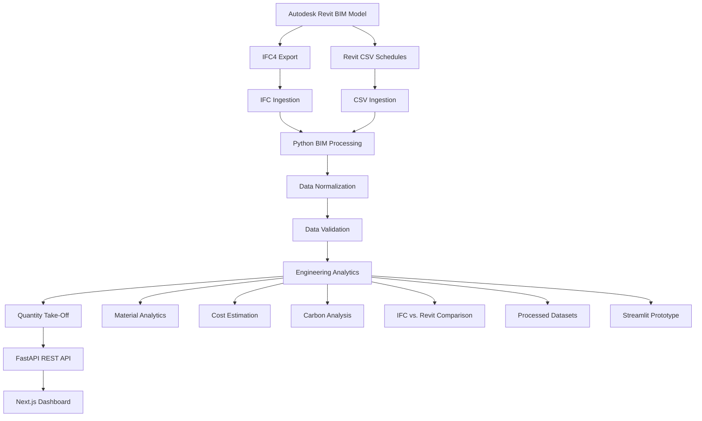
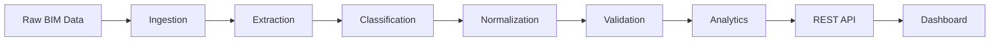
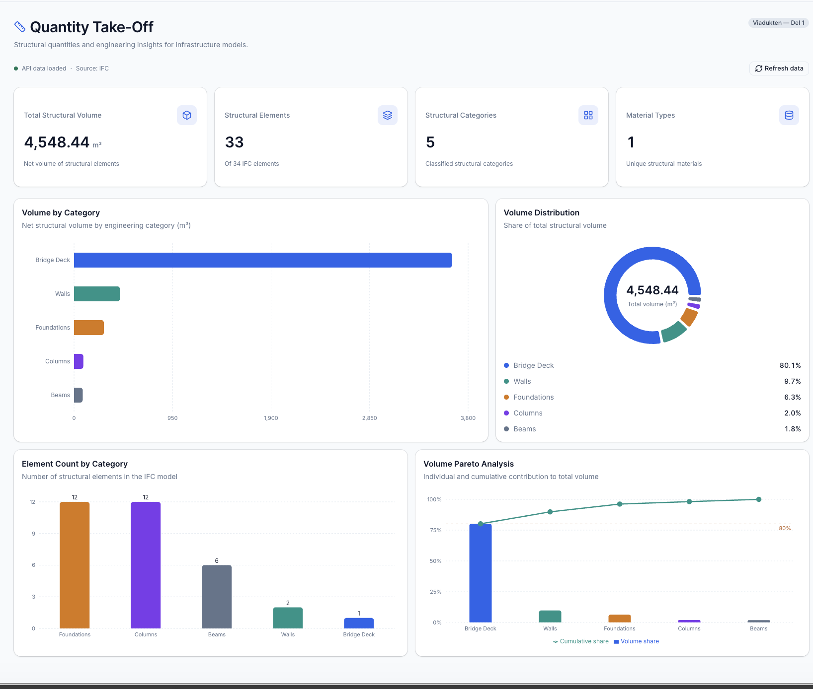
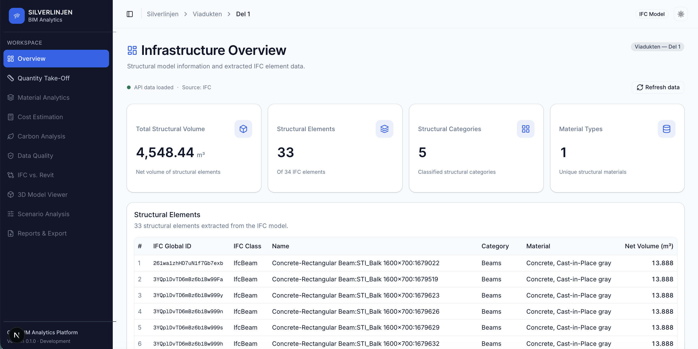
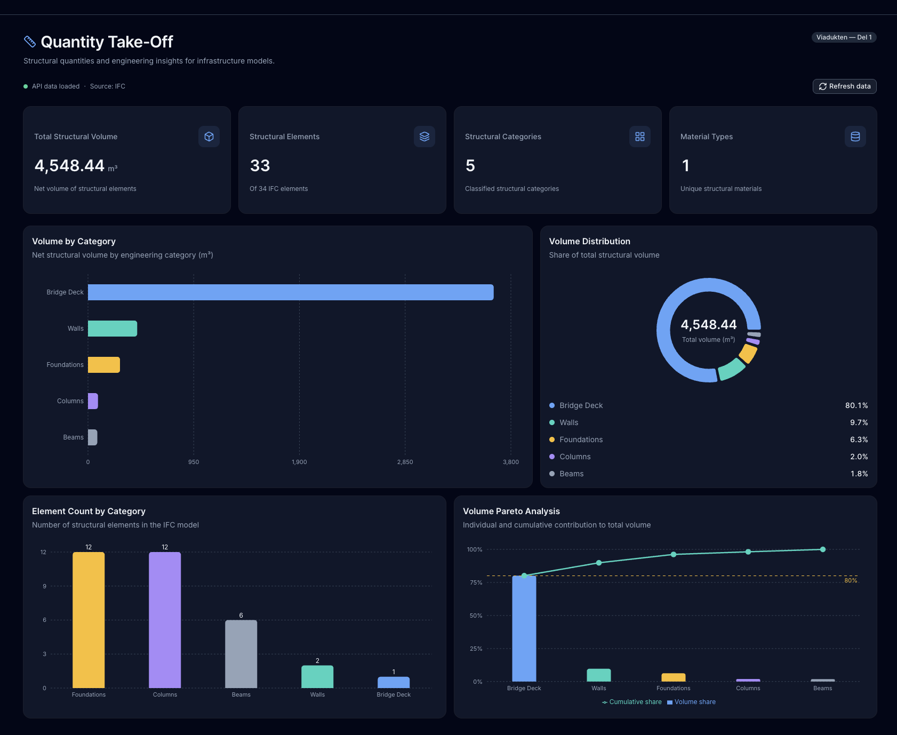
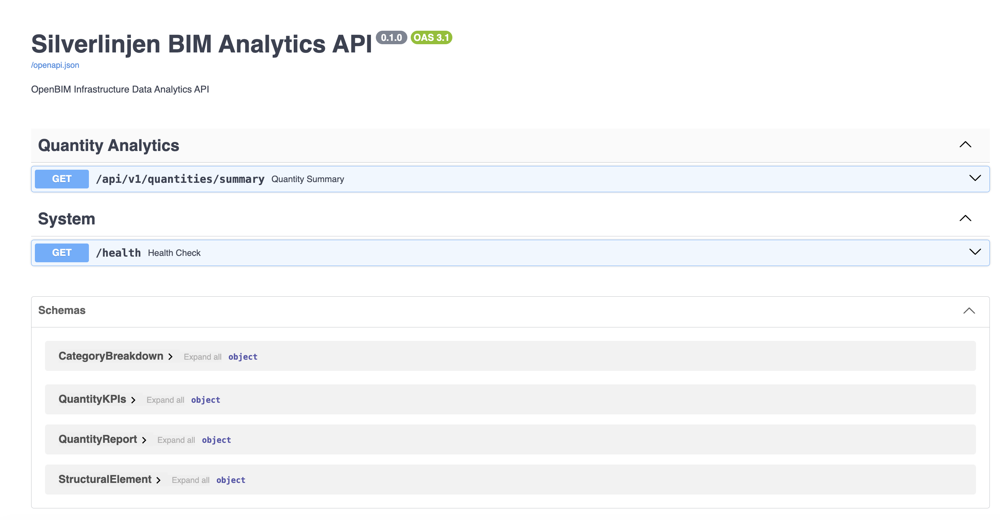

<p align="center">
  
</p>

<h1 align="center">Silverlinjen BIM Analytics</h1>

<p align="center">
  <strong>OpenBIM Infrastructure Data Analytics Platform</strong>
</p>

<p align="center">
  Connecting BIM, Infrastructure Engineering, and Software Development
</p>

<p align="center">
  
  
  
  
  
  
  
</p>

---

## Table of Contents

- [Project Overview](#project-overview)
- [Project Background](#project-background)
- [Problem Statement](#problem-statement)
- [Project Objectives](#project-objectives)
- [BIM Use Case](#bim-use-case)
- [Infrastructure Model](#infrastructure-model)
- [Key Features](#key-features)
- [Dashboard](#dashboard)
- [Engineering Results](#engineering-results)
- [System Architecture](#system-architecture)
- [Data Processing Pipeline](#data-processing-pipeline)
- [Technology Stack](#technology-stack)
- [Repository Structure](#repository-structure)
- [Getting Started](#getting-started)
- [REST API](#rest-api)
- [Testing and Validation](#testing-and-validation)
- [Current Limitations](#current-limitations)
- [Development Roadmap](#development-roadmap)
- [Learning Outcomes](#learning-outcomes)
- [About the Developer](#about-the-developer)
- [Disclaimer](#disclaimer)

---

## Project Overview

Silverlinjen BIM Analytics is an independently developed
BIM data analytics platform focused on infrastructure
engineering and OpenBIM workflows.

The platform transforms Building Information Modeling
(BIM) data into structured, validated, and actionable
engineering information.

It combines infrastructure modeling in Autodesk Revit,
IFC-based data extraction, Python data processing,
REST API development, and interactive web visualization.

The current implementation focuses on structural
quantity take-off (QTO), material analysis, model data
validation, and preliminary cost and embodied carbon
estimation.

The project demonstrates how BIM models can be used
not only for design and visualization, but also as
structured data sources for engineering analysis
and data-driven decision-making.

---

## Project Background

Silverlinjen BIM Analytics was initiated as a personal
portfolio project alongside my BIM engineering studies
at Stockholms Tekniska Institut (STI), Sweden.

The underlying infrastructure model is based on an
educational metro infrastructure project:

| Property | Description |
|---|---|
| Project | Silverlinjen |
| Location within project | Granhöjden |
| Model | Viadukten |
| Section | Del 1 |
| Infrastructure type | Metro viaduct / bridge |
| Modeling software | Autodesk Revit |
| Exchange format | IFC4 Reference View |
| Project purpose | Education and technical portfolio |

The structural model was developed in Revit and
exported to IFC and CSV formats for further analysis.

The analytics platform extends the educational BIM
model into a software engineering project by connecting
model information with automated data processing,
engineering calculations, validation, and visualization.

---

## Problem Statement

BIM models contain valuable engineering information,
including geometry, material properties, classifications,
and quantities.

However, this information is not always immediately
accessible for analysis outside traditional BIM
authoring software.

Common challenges include:

- Extracting structured engineering data from BIM models.
- Managing inconsistent element classifications.
- Identifying missing or incomplete model information.
- Verifying quantities across different data sources.
- Reusing model data for cost and environmental analysis.
- Presenting technical information in an accessible format.
- Reducing repetitive manual data processing.
- Supporting interoperability between software platforms.

Silverlinjen BIM Analytics explores how OpenBIM,
data engineering, and modern software development
can help address these challenges.

---

## Project Objectives

The main objectives of the project are to:

- Develop an automated BIM data extraction pipeline.
- Process IFC models using open-source technologies.
- Normalize engineering information into consistent
  data structures.
- Validate structural quantities and model information.
- Compare quantities extracted from IFC and Revit.
- Provide an interactive engineering analytics dashboard.
- Estimate preliminary material costs and embodied carbon.
- Develop a modular and extensible software architecture.
- Explore future applications of BIM data in digital twins.

---

## BIM Use Case

The primary BIM use case implemented in this project
is **Quantity Take-Off (QTO)**.

The use case was selected with inspiration from
buildingSMART's Use Case Management (UCM) framework
and infrastructure-oriented BIM workflows.

| Property | Description |
|---|---|
| Use case | Quantity Take-Off |
| Swedish terminology | Mängdavtagning |
| Domain | Infrastructure engineering |
| Asset type | Bridge / metro viaduct |
| Input | IFC model and Revit schedules |
| Processing | Automated BIM data extraction and validation |
| Output | Structured quantities and engineering reports |
| Primary purpose | Quantity verification and engineering analysis |

### Use Case Workflow

1. Develop the structural BIM model in Revit.
2. Export the model using the IFC exchange format.
3. Export relevant Revit quantity schedules as CSV.
4. Extract structural elements and quantities.
5. Normalize classifications, materials, and units.
6. Validate extracted model information.
7. Compare aggregated IFC and Revit quantities.
8. Generate engineering analytics.
9. Present results through an interactive dashboard.

### OpenBIM Approach

The platform uses IFC as a software-independent
exchange format.

Instead of relying exclusively on proprietary BIM
authoring software, the analytics engine accesses
model information through IfcOpenShell.

This approach supports interoperability and creates
a foundation for future integration with other
BIM tools and information management workflows.

---

## Infrastructure Model

The current reference model represents a simplified
reinforced concrete metro viaduct.

### Structural Components

The model consists of five structural categories:

| Category | IFC Representation |
|---|---|
| Bridge Deck | IfcSlab |
| Structural Foundations | IfcSlab in the exported model |
| Structural Columns | IfcColumn |
| Structural Beams | IfcBeam |
| Structural Walls | IfcWall / applicable IFC wall subtype |

The foundations in the current IFC export are
represented as IfcSlab objects rather than IfcFooting.

The processing pipeline handles this through
classification rules while preserving the original
IFC entity information.

This demonstrates the importance of semantic
classification when processing BIM data from
different authoring and exchange workflows.

### Model Development

The model was developed using Autodesk Revit.

The engineering analytics platform subsequently
processes exported model information, including:

- IFC Global IDs
- IFC entity classes
- Element names
- Structural categories
- Material information
- Geometric dimensions
- Net and gross volumes
- Surface areas
- Classification information

The availability of individual properties depends
on the information included in the IFC export.

---

## Key Features

### 1. IFC Data Extraction

Automated extraction of BIM information using
IfcOpenShell.

The extraction process supports:

- IFC model loading
- Element identification
- IFC entity classification
- Global ID extraction
- Material extraction
- Quantity extraction
- Structural element filtering

### 2. Revit CSV Integration

The platform processes quantity schedules exported
from Autodesk Revit.

Supported structural schedules include:

- Floors
- Structural foundations
- Structural framing
- Structural columns
- Walls

The CSV files are combined into a normalized
dataset for analysis and comparison.

### 3. Data Normalization

BIM information from different sources is transformed
into consistent engineering data structures.

Normalization includes:

- Column name standardization
- Structural category mapping
- Material name handling
- Unit conversion
- Numerical value normalization
- Missing value handling
- Source metadata preservation

### 4. Quantity Take-Off

Automated quantity analysis provides:

- Total structural volume
- Structural element counts
- Category-level quantities
- Material quantities
- Average element volume
- Minimum and maximum element volumes
- Percentage contribution by structural category

### 5. Data Quality Analysis

The Python analytics engine includes checks for:

- Missing IFC Global IDs
- Duplicate IFC Global IDs
- Missing materials
- Missing quantities
- Invalid numerical values
- Non-positive volumes
- Unclassified structural elements
- Missing Revit element marks

These checks help identify information quality
issues before further engineering analysis.

### 6. IFC and Revit Quantity Comparison

Aggregated quantities extracted from IFC are
compared with Revit quantity schedules.

The comparison process evaluates:

- Structural categories
- Element counts
- Total volumes
- Absolute quantity differences
- Relative quantity differences
- Configurable numerical tolerances

The current comparison operates at structural
category level rather than individual element level.

### 7. Material Analytics

The Python analytics engine supports:

- Material-based element grouping
- Total volume by material
- Material distribution
- Material quantities by structural category
- Material coverage analysis

### 8. Preliminary Cost Estimation

Material quantities can be combined with
external unit price reference data.

The current calculation is based on:

    Material Cost = Material Volume × Unit Price

The cost engine supports:

- Total estimated material cost
- Cost breakdown by structural category
- Material price coverage
- Identification of missing price information

Current unit prices are demonstration values
rather than verified construction market prices.

### 9. Preliminary Carbon Estimation

The platform supports basic embodied carbon
calculations based on material quantities.

    Embodied Carbon = Material Volume × Emission Factor

The current implementation uses demonstration
emission factors for lifecycle stages A1–A3.

Supported calculations include:

- Total estimated embodied carbon
- Carbon contribution by structural category
- Material emission factor coverage
- Identification of missing emission factors

This functionality demonstrates the integration
of BIM quantities with environmental reference data.

It is not a complete lifecycle assessment (LCA).

### 10. Interactive Web Dashboard

The web application provides:

- Infrastructure overview
- Structural element data table
- Quantity take-off report
- Engineering KPI cards
- Interactive engineering charts
- Responsive page layouts
- Light and dark themes
- API integration
- Loading and error handling

---

## Dashboard

The frontend is developed using Next.js, TypeScript,
Tailwind CSS, shadcn/ui, and Recharts.

The dashboard is designed to make technical BIM
information accessible through a modern engineering
analytics interface.

### Infrastructure Overview

The overview provides general model information
and access to extracted structural element data.

Displayed information includes:

- Total structural volume
- Number of structural elements
- Number of structural categories
- Number of material types
- IFC Global IDs
- IFC entity classes
- Element names
- Structural categories
- Material information
- Net element volumes

### Quantity Take-Off Dashboard

The Quantity Take-Off report provides four
engineering visualizations.

| Visualization | Purpose |
|---|---|
| Volume by Category | Compare structural material volumes |
| Volume Distribution | Understand relative volume contribution |
| Element Count | Compare the number of structural elements |
| Pareto Analysis | Identify dominant contributors to total volume |

All report values are retrieved from the Python
backend rather than hardcoded into frontend components.

### Streamlit Prototype

An earlier Streamlit dashboard was developed
to explore BIM data and validate the analytics workflow.

The Streamlit application remains part of the
project as a lightweight Python-based prototype.

The Next.js application represents a more modular
and extensible frontend implementation.

---

## Engineering Results

The following results were obtained from the
current educational viaduct model.

### Structural Quantity Summary

| Structural Category | Elements | Net Volume (m³) | Volume Share |
|---|---:|---:|---:|
| Bridge Deck | 1 | 3,645.000 | 80.14% |
| Walls | 2 | 442.260 | 9.72% |
| Foundations | 12 | 288.000 | 6.33% |
| Columns | 12 | 89.856 | 1.98% |
| Beams | 6 | 83.328 | 1.83% |
| **Total** | **33** | **4,548.444** | **100%** |

### Model Key Performance Indicators

| Indicator | Result |
|---|---:|
| Extracted IFC elements | 34 |
| Structural elements | 33 |
| Excluded elements | 1 |
| Structural categories | 5 |
| Unique structural materials | 1 |
| Total structural volume | 4,548.444 m³ |

One non-structural reference element is excluded
from the structural quantity calculations.

### Engineering Insight

The bridge deck represents approximately 80.14%
of the total structural material volume, despite
being modeled as a single structural element.

This illustrates why element counts alone are
insufficient for understanding material consumption.

Quantity-based analysis can help identify which
structural categories should receive further
attention during cost and environmental assessments.

The results describe the modeled quantities and
should not be interpreted as structural design
or material reduction recommendations.

### IFC vs. Revit Validation

| Validation Metric | Result |
|---|---:|
| Compared structural categories | 5 |
| Matching structural categories | 5 |
| Category-level match rate | 100% |
| IFC structural elements | 33 |
| Revit structural elements | 33 |
| Volume comparison tolerance | 0.001 m³ |
| Quantity comparison | Passed |

Aggregated structural quantities from IFC and
Revit match within the defined tolerance.

This confirms consistency between the two exported
datasets at category level.

It does not independently verify geometry accuracy
or establish individual element-level equivalence.

### Data Quality Results

| IFC Data Quality Check | Result |
|---|---:|
| Duplicate Global IDs | 0 |
| Missing Global IDs | 0 |
| Missing structural materials | 0 |
| Missing structural volumes | 0 |
| Non-finite structural volumes | 0 |
| Non-positive structural volumes | 0 |
| Unclassified structural elements | 0 |

The Revit CSV dataset contains 33 missing element
marks, which is recorded as an information quality
issue.

### Demonstration Cost and Carbon Results

| Indicator | Result |
|---|---:|
| Total concrete volume | 4,548.444 m³ |
| Assumed concrete unit price | 2,500 SEK/m³ |
| Estimated concrete material cost | 11,371,110 SEK |
| Assumed emission factor | 250 kgCO₂e/m³ |
| Estimated embodied carbon | 1,137.111 tCO₂e |
| Lifecycle stages | A1–A3 |

These results are calculated using demonstration
reference values.

They are intended to illustrate the analytical
workflow rather than represent verified project
costs or environmental performance.

The cost estimate does not include labor,
reinforcement, equipment, transportation,
installation, or other construction expenses.

---

## System Architecture

The platform follows a modular architecture
that separates BIM data processing, engineering
analytics, API services, and frontend visualization.



### Architecture Principles

- Separation of concerns
- Modular software development
- Reusable analytics functions
- Centralized engineering calculations
- Structured API responses
- Runtime data validation
- Type-safe frontend development
- OpenBIM interoperability
- Extensible reporting architecture

The Python backend is responsible for the main
engineering calculations.

The frontend is responsible for data presentation,
visualization, and user interaction.

---

## Data Processing Pipeline



### Processing Stages

| Stage | Description |
|---|---|
| Ingestion | Load IFC and CSV source files |
| Extraction | Retrieve model properties and quantities |
| Classification | Identify engineering categories |
| Normalization | Standardize values and units |
| Validation | Identify missing or inconsistent information |
| Analytics | Generate engineering metrics |
| API | Expose structured analytical results |
| Visualization | Present results in the dashboard |

### Data Sources

| Source | Format | Purpose |
|---|---|---|
| Revit model export | IFC4 | Primary structural BIM information |
| Revit quantity schedules | CSV | Independent quantity comparison |
| Material prices | CSV | Preliminary cost estimation |
| Emission factors | CSV | Preliminary carbon estimation |

### Processed Data

The research and processing workflows generate
structured datasets such as:

- `ifc_elements.csv`
- `ifc_structural_elements.csv`
- `ifc_quantity_summary.csv`
- `ifc_quality_summary.csv`
- `revit_elements.csv`
- `revit_quantity_summary.csv`
- `revit_quality_summary.csv`
- `ifc_revit_comparison.csv`
- `ifc_revit_validation_summary.csv`

---

## Technology Stack

### BIM and Engineering

| Technology | Purpose |
|---|---|
| Autodesk Revit | Infrastructure modeling |
| IFC4 | OpenBIM data exchange |
| Revit Schedules | Structural quantity extraction |
| IfcOpenShell | IFC parsing and model processing |
| buildingSMART UCM | BIM use case methodology inspiration |

### Backend and Data Engineering

| Technology | Purpose |
|---|---|
| Python 3.12 | Core analytics engine |
| Pandas | Data processing and aggregation |
| NumPy | Numerical operations |
| FastAPI | REST API development |
| Pydantic | API data schemas |
| Uvicorn | ASGI application server |
| Jupyter Notebook | Data exploration and research |
| uv | Python dependency management |
| Pytest | Automated testing |

### Frontend

| Technology | Purpose |
|---|---|
| Next.js 16 | Web application framework |
| React | Component-based user interface |
| TypeScript | Type-safe frontend development |
| Tailwind CSS | Styling and responsive design |
| shadcn/ui | Reusable UI components |
| Base UI | Accessible UI primitives |
| Recharts | Engineering data visualization |
| TanStack Query | API state and cache management |
| Zod | Runtime API response validation |
| Lucide React | Interface icons |
| next-themes | Light and dark theme management |
| Inter | Application typography |

### Prototyping

| Technology | Purpose |
|---|---|
| Streamlit | Initial Python dashboard |
| Jupyter Notebook | Exploratory BIM data analysis |

---

## Repository Structure

The project is organized into separate application,
analytics, data, research, and testing modules.

```text
silverlinjen-bim-analytics/
│
├── apps/
│   ├── api/
│   │   ├── routes/
│   │   ├── schemas/
│   │   ├── services/
│   │   └── main.py
│   │
│   ├── dashboard/
│   │   ├── components/
│   │   ├── views/
│   │   └── app.py
│   │
│   └── frontend/
│       ├── public/
│       ├── src/
│       │   ├── app/
│       │   ├── components/
│       │   │   ├── brand/
│       │   │   ├── charts/
│       │   │   ├── common/
│       │   │   ├── layout/
│       │   │   ├── providers/
│       │   │   ├── reports/
│       │   │   └── ui/
│       │   ├── config/
│       │   ├── hooks/
│       │   ├── lib/
│       │   │   ├── api/
│       │   │   └── schemas/
│       │   ├── types/
│       │   └── utils/
│       ├── .env.example
│       └── package.json
│
├── core/
│   ├── analytics/
│   ├── config/
│   ├── ingestion/
│   ├── processing/
│   ├── schemas/
│   ├── validation/
│   └── pipeline.py
│
├── data/
│   ├── raw/
│   │   └── viadukten/
│   ├── processed/
│   ├── reference/
│   └── research/
│       ├── 01_ifc_exploration.ipynb
│       └── 02_csv_exploration.ipynb
│
├── docs/
│   └── assets/
│
├── scripts/
│
├── tests/
│
├── pyproject.toml
├── uv.lock
├── .gitignore
└── README.md
```

---

## Getting Started

### Prerequisites

The following tools are required:

- Python 3.12
- uv
- Node.js 24
- npm
- Git

Autodesk Revit is required only when developing
or modifying the original BIM model.

The analytics platform can process an exported
IFC file without requiring an active Revit installation.

### 1. Clone the Repository

```bash
git clone <repository-url>

cd silverlinjen-bim-analytics
```

### 2. Install Python Dependencies

```bash
uv sync
```

### 3. Prepare BIM Data

The application expects the reference IFC model
and associated source files in the configured
data directory.

```text
data/raw/viadukten/
```

The primary IFC model is:

```text
viadukten.ifc
```

If the source files are not included in the
repository, they must be provided separately.

### 4. Start the Backend

From the project root:

```bash
uv run uvicorn apps.api.main:app \
  --reload \
  --port 8000
```

Backend URL:

```text
http://localhost:8000
```

Swagger API documentation:

```text
http://localhost:8000/docs
```

### 5. Install Frontend Dependencies

Open a separate terminal:

```bash
cd apps/frontend

npm ci
```

### 6. Configure Environment Variables

```bash
cp .env.example .env.local
```

Environment configuration:

```env
NEXT_PUBLIC_API_URL=http://127.0.0.1:8000/api/v1
```

### 7. Start the Frontend

```bash
npm run dev
```

Open the dashboard:

```text
http://localhost:3000
```

Available application pages:

```text
http://localhost:3000/overview
http://localhost:3000/quantities
```

### 8. Run the Streamlit Prototype (Optional)

From the project root:

```bash
uv run python -m streamlit run apps/dashboard/app.py
```

Default Streamlit address:

```text
http://localhost:8501
```

---

## REST API

The backend exposes structured engineering data
through a FastAPI REST API.

### Available Endpoints

| Method | Endpoint | Description |
|---|---|---|
| GET | `/health` | Application health status |
| GET | `/api/v1/quantities/summary` | Structural quantity report |
| GET | `/docs` | Interactive Swagger documentation |
| GET | `/redoc` | Alternative API documentation |
| GET | `/openapi.json` | OpenAPI specification |

### Health Check

```bash
curl http://localhost:8000/health
```

Example response:

```json
{
  "status": "healthy",
  "service": "silverlinjen-bim-api",
  "version": "0.1.0"
}
```

### Quantity Report

```bash
curl http://localhost:8000/api/v1/quantities/summary
```

Example excerpt from the response:

```json
{
  "project": "Silverlinjen",
  "model": "Viadukten",
  "section": "Del 1",
  "source": "IFC",
  "kpis": {
    "total_elements": 34,
    "structural_elements": 33,
    "excluded_elements": 1,
    "total_volume_m3": 4548.444,
    "category_count": 5,
    "material_count": 1
  }
}
```

The complete response also includes:

- Category-level quantity breakdowns
- Individual structural elements
- Material information
- IFC entity information
- Net structural volumes

API responses are validated using Pydantic in
the backend and Zod in the frontend.

---

## Testing and Validation

The project includes automated Python tests
for core BIM data processing and analytics.

### Test Coverage Areas

- Data normalization
- Structural classification
- Data quality validation
- Quantity comparison
- Processing pipelines
- Engineering analytics

### Run Backend Tests

From the project root:

```bash
uv run pytest -v
```

The last recorded Python test run:

```text
34 passed
```

### Frontend Validation

From `apps/frontend`:

```bash
npm run lint

npx tsc --noEmit

npm run build
```

These commands verify:

- Code quality through ESLint
- TypeScript type correctness
- Production build compatibility

### Numerical Validation

The project uses numerical tolerances when
comparing engineering quantities.

Floating-point differences are handled during
validation rather than requiring exact binary
equality between numerical values.

---

## Current Limitations

Silverlinjen BIM Analytics is currently a
portfolio-oriented development project.

The current limitations include:

- Analysis is focused on a single reference BIM model.
- The educational structural geometry is simplified.
- IFC and Revit comparisons operate at category level.
- Individual element-level cross-source matching is
  not implemented.
- Some Revit identification fields are incomplete.
- Cost calculations use demonstration material prices.
- Carbon calculations use demonstration emission factors.
- Carbon analysis is limited to A1–A3.
- Advanced reporting capabilities are not yet exposed
  through dedicated API endpoints.
- The frontend currently focuses on overview and
  quantity take-off functionality.
- IFC data is cached in the backend during execution.
- Multi-model management is not implemented.
- Authentication and authorization are not implemented.
- Production deployment is not configured.
- Development dependency security advisories
  remain under review.

---

## Development Roadmap

### Phase 1 — BIM Data Research

- [x] Infrastructure model development in Revit
- [x] IFC model export
- [x] Revit CSV schedule export
- [x] IFC data exploration
- [x] CSV data exploration
- [x] Jupyter research notebooks
- [x] Structured dataset generation

### Phase 2 — Python BIM Analytics Engine

- [x] IFC data ingestion
- [x] CSV data ingestion
- [x] Engineering classification
- [x] Data normalization
- [x] Quantity extraction
- [x] Data quality validation
- [x] IFC and Revit quantity comparison
- [x] Quantity analytics
- [x] Material analytics
- [x] Preliminary cost analytics
- [x] Preliminary carbon analytics
- [x] Automated Python testing

### Phase 3 — API and Dashboard

- [x] Streamlit prototype
- [x] FastAPI backend
- [x] Structured API schemas
- [x] Quantity report endpoint
- [x] Next.js frontend setup
- [x] Responsive dashboard layout
- [x] Light and dark themes
- [x] Runtime API validation
- [x] Frontend data integration
- [x] Engineering KPI cards
- [x] Volume bar chart
- [x] Volume distribution chart
- [x] Element count chart
- [x] Pareto analysis chart
- [x] Infrastructure overview
- [x] Structural element data table

### Phase 4 — Advanced Engineering Analytics

- [ ] Interactive category and material filtering
- [ ] Cross-filtering between charts
- [ ] Advanced structural data table
- [ ] Engineering insights
- [ ] Material analytics dashboard
- [ ] Cost estimation dashboard
- [ ] Carbon analytics dashboard
- [ ] Data quality dashboard
- [ ] IFC vs. Revit validation dashboard
- [ ] CSV and Excel report exports

### Phase 5 — BIM Platform Expansion

- [ ] Interactive 3D IFC model viewer
- [ ] Global ID-based element selection
- [ ] Integration of 3D models and analytics
- [ ] Multi-model support
- [ ] Model version management
- [ ] Database integration
- [ ] Scenario analysis
- [ ] User authentication
- [ ] Common Data Environment (CDE) integration research

### Phase 6 — Digital Twin Research

- [ ] Simulated infrastructure sensor data
- [ ] Time-series data processing
- [ ] Structural monitoring dashboard
- [ ] Asset condition visualization
- [ ] Sensor-to-BIM element mapping
- [ ] Digital twin prototype

The digital twin phase represents a future research
direction and is not part of the current implementation.

---

## Learning Outcomes

This project provides practical experience in
combining BIM engineering and software development.

### BIM Engineering

- Infrastructure modeling
- Structural BIM information
- OpenBIM workflows
- IFC data structures
- Quantity take-off
- Material quantities
- BIM use case methodology
- BIM information quality
- Engineering classifications
- Model interoperability

### Data Engineering

- Data extraction
- Data transformation
- Data normalization
- Engineering unit handling
- Data quality assessment
- Dataset comparison
- Numerical validation
- Automated analytical workflows
- Exploratory data analysis

### Software Engineering

- Modular Python architecture
- REST API development
- API schema design
- Type-safe frontend development
- Runtime validation
- Reusable UI components
- Interactive visualization
- Automated testing
- Full-stack application development

### Infrastructure Sustainability

- Material quantity analysis
- Preliminary cost estimation
- Embodied carbon estimation
- Environmental reference data
- Lifecycle stage awareness
- Data-driven sustainability analysis

---

## About the Developer

I am a BIM engineering student at Stockholms
Tekniska Institut (STI), Sweden, with a background
in full-stack software development.

My professional interests include:

- BIM engineering
- Infrastructure and construction technology
- OpenBIM and IFC interoperability
- BIM automation
- Python-based engineering applications
- Data engineering and visualization
- Sustainable infrastructure
- Digital twins
- Smart infrastructure

Silverlinjen BIM Analytics represents my interest
in bridging the gap between traditional engineering
workflows and modern software development.

The project demonstrates how my software engineering
background can be applied to BIM, infrastructure
projects, automated engineering workflows, and
data-driven decision-making.

I am particularly interested in developing digital
tools that make engineering information more
accessible, reliable, and useful throughout
the infrastructure lifecycle.

---

## Disclaimer

This project is developed for educational,
research, and professional portfolio purposes.

The reference infrastructure model is based
on an educational metro viaduct assignment.

It is not an official construction project
or an approved structural design.

The presented quantities reflect the information
contained in the current BIM model.

Cost and environmental calculations are based on
demonstration reference values and should not
be used for procurement, construction planning,
structural engineering decisions, or verified
lifecycle assessments without further validation.

The project is independently developed and is
not an official product of Autodesk, buildingSMART,
or Stockholms Tekniska Institut.

---

<p align="center">
  
</p>

<p align="center">
  <strong>Silverlinjen BIM Analytics</strong>
</p>

<p align="center">
  Engineering Information Beyond the BIM Model
</p>

<p align="center">
  Developed in Stockholm, Sweden
</p>

## Project Preview

### Infrastructure BIM Model

<p align="center">
  
</p>

*Structural BIM model developed in Autodesk Revit.*

### Quantity Take-Off Dashboard

<p align="center">
  
</p>

*Interactive engineering analytics powered by
real IFC model data.*

### Infrastructure Overview

<p align="center">
  
</p>

*Structured BIM information extracted from
the IFC model.*

### Dark Mode

<p align="center">
  
</p>

### REST API Documentation

<p align="center">
  
</p>